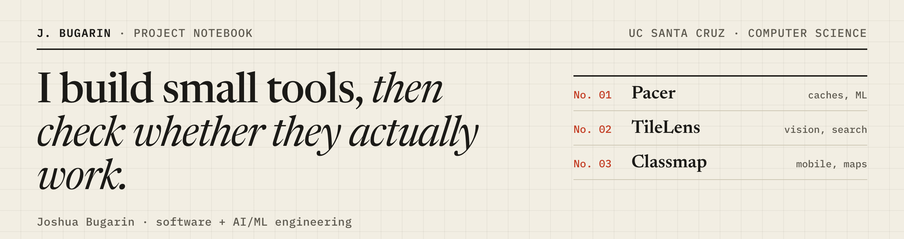
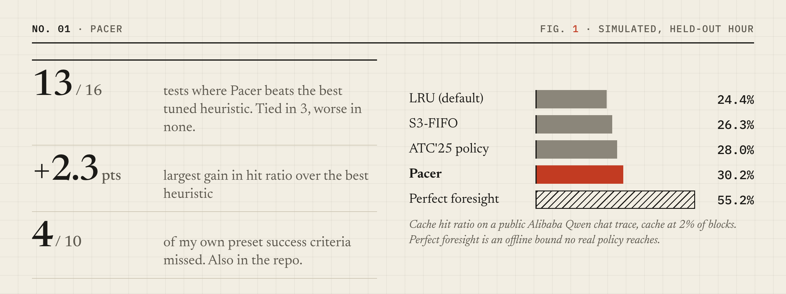
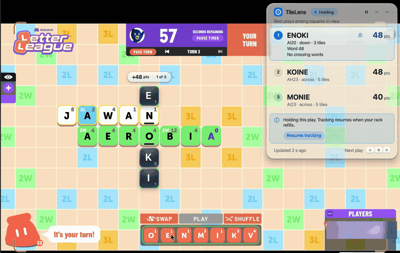
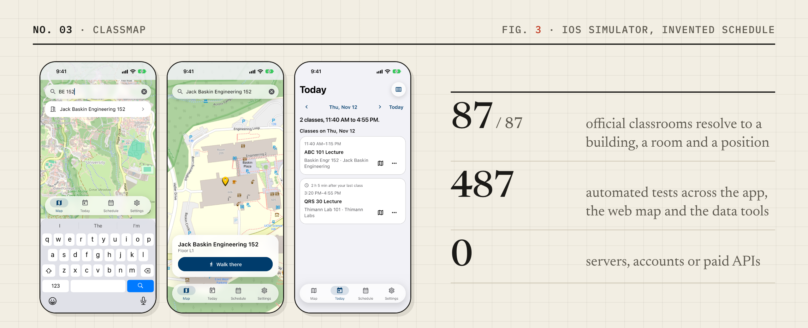

<picture>
  <source media="(prefers-color-scheme: dark)" srcset="assets/banner-dark.png">
  
</picture>

I'm Joshua, a computer science student at UC Santa Cruz with a computer engineering minor, heading toward software and AI/ML engineering. I like projects where the answer can be measured: a cache that hits more often, a board read correctly, a classroom that resolves to an actual door.

Three entries so far. I built each one solo, and each repo keeps its numbers next to its misses.

## No. 01 · Pacer

**What should an LLM cache forget?**

<picture>
  <source media="(prefers-color-scheme: dark)" srcset="assets/pacer-dark.png">
  
</picture>

When an LLM server runs out of room, it throws away cached prompt prefixes and later pays to recompute them. Pacer trains a small model to guess which blocks will be needed again, and tests that guess in a Rust simulator of 16 eviction policies on four public Alibaba Qwen production traces.

- **Result:** ahead of the best tuned heuristic in 13 of 16 trace and cache-size combinations, tied in 3, behind in none. All of it is simulation on a held-out hour, not a production deployment.
- **The part I'm proudest of:** I wrote ten success criteria before building anything. Four failed. [They're in the repo too.](https://github.com/JMBugarin/pacer/blob/main/docs/criteria.md)
- **Built with:** Rust, Python, LightGBM, PyO3, MLX

[Repository](https://github.com/JMBugarin/pacer) · [Full results](https://github.com/JMBugarin/pacer/blob/main/docs/results.md) · [38-second terminal demo](assets/pacer-demo.mp4)

## No. 02 · TileLens

**It reads the board off the screen.**

<b>Fig. 2</b> · A live Letter League game in Discord, 11 Nov 2026. Player card blurred.

TileLens watches a tile game the way a player does, from pixels. It finds the board, reads every tile and its point value, searches every legal word placement, lists the best three, and draws the top one on the board as ghost tiles. Everything runs locally. It never clicks for you; it just quietly knows the word you were about to miss.

- **Result:** 2.2 ms median to search a mid-game 13×13 board against a 204,000-word list, checked against a brute-force solver on 400 seeded positions in every test run.
- **The part I'm proudest of:** a tile it can't read is flagged, never guessed. Zero silent misreads on the synthetic test boards.
- **Built with:** Python, OpenCV, NumPy, PySide6, a DAWG move generator in its own process

[Repository](https://github.com/JMBugarin/tilelens) · [Limits](https://github.com/JMBugarin/tilelens/blob/main/docs/limits.md) · [50-second live recording](assets/tilelens-live.mp4)

## No. 03 · Classmap

**Your class schedule, on the campus map.**

<picture>
  <source media="(prefers-color-scheme: dark)" srcset="assets/classmap-dark.png">
  
</picture>

A schedule says "Baskin Engr 152". Your maps app shrugs. Classmap is an offline Flutter app that knows where UC Santa Cruz's classrooms are, imports a schedule by paste, calendar file or photo, and hands the door's location to your own maps app for the walk. A separate web map adds walking routes over the campus path network.

- **Result:** all 87 official general-assignment classrooms resolve to a building, a room and a position, with no server, account or paid API.
- **The honest caveat:** tested in the iOS Simulator, not yet on a physical phone.
- **Built with:** Flutter, Dart, Swift (Apple Vision), TypeScript, React, MapLibre, a Python pipeline over OpenStreetMap

[Repository](https://github.com/JMBugarin/ucsc-campus-router-v2) · [What is and isn't verified](https://github.com/JMBugarin/ucsc-campus-router-v2/blob/main/docs/status.md) · [49-second app walkthrough](assets/classmap-ios.mp4)

## Also in the notebook

- **Ethocal** (team project, private repo). A Flutter app for sustainable shopping. The concept won the DesignVerse Hackathon at UC Riverside with a team of five. I built the messaging interface, the profile pages, the schedule and edit-event pages, and the event details page.

## How I work

- **Measure first, then brag a little.** Every number above comes from a benchmark or test in the repo, and says what it was measured on.
- **Write the test that can embarrass me.** A brute-force solver to check the fast one. A reference simulator to check the Rust one.
- **Publish the misses.** Limits and failed criteria live beside the results.

## Find me

- **Code:** [github.com/JMBugarin](https://github.com/JMBugarin?tab=repositories)
- **LinkedIn:** [linkedin.com/in/Joshua-bugarin](https://linkedin.com/in/Joshua-bugarin)
